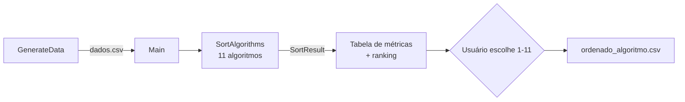

# ADO 03 — Algoritmos de Ordenação

**Disciplina:** Estrutura de Dados e Ordenação  
**Prof.:** MSc. Edgar Cabral  
**Linguagem:** Java  

Implementação e benchmark de 11 algoritmos de ordenação sobre 100.000 números, medindo tempo, comparações e trocas de cada um.

---

## Como rodar

Requer JDK 11 ou superior.

```bash
# 1. Compilar
javac GenerateData.java SortResult.java SortAlgorithms.java Main.java

# 2. Gerar os dados (cria dados.csv com 100.000 valores)
java -Duser.language=en -Duser.country=US GenerateData

# 3. Executar o sistema
java -Duser.language=en -Duser.country=US Main dados.csv
```

O programa roda os 11 algoritmos, mostra o tempo de cada um e pergunta qual usar para gerar o arquivo ordenado (`ordenado_<algoritmo>.csv`).

> Por que o `-Duser.language=en`? O `GenerateData` grava os números com `String.format("%.2f")`, que segue o locale do sistema. Em pt-BR sai `727563,68`, e o `Main` separa os valores por vírgula, então cada número vira dois e a base passa a ter 200.000 inteiros. Com o locale em inglês o separador decimal é ponto e o CSV fica correto.



---

## Estrutura do projeto

| Arquivo | O que faz |
|---|---|
| `GenerateData.java` | Gera o CSV com 100k valores aleatórios |
| `SortResult.java` | Classe que guarda as métricas de cada execução |
| `SortAlgorithms.java` | Os 11 algoritmos implementados com contadores |
| `Main.java` | Lê o CSV, mede os tempos, exibe tabela de métricas, menu do usuário |

---

## O que é medido em cada algoritmo

Cada algoritmo retorna um objeto `SortResult` com quatro informações:

| Métrica | O que representa |
|---|---|
| **Tempo (ms)** | Tempo real de execução em milissegundos |
| **Comparações** | Quantas vezes dois elementos foram comparados entre si |
| **Trocas** | Quantas vezes um elemento foi movido/escrito no array |
| **Passos totais** | Comparações + Trocas — custo total de operações |

A tabela final ainda mostra um **ranking dos algoritmos mais rápidos** rodando na base completa de 100k elementos.

Saída real (JDK 25, Apple Silicon; os tempos mudam a cada execução e máquina):

```
=========================================================================================================
Nº   Algoritmo          Tempo(ms)          Comparações               Trocas          Passos totais  Nota
---------------------------------------------------------------------------------------------------------
1    Bubble Sort              204           49,973,055           25,108,117             75,081,172  [amostra 10,000 elem.]
2    Selection Sort           146           49,995,000                9,991             50,004,991  [amostra 10,000 elem.]
3    Insertion Sort            47           25,118,101           25,108,117             50,226,218  [amostra 10,000 elem.]
4    Merge Sort                29            1,536,281            3,337,856              4,874,137  [100,000 elem.]
5    Quick Sort                61            1,925,693            1,071,883              2,997,576  [100,000 elem.]
6    Heap Sort                 64            3,019,507            1,574,627              4,594,134  [100,000 elem.]
7    Counting Sort             29            1,199,986              200,000              1,399,986  [100,000 elem.]
8    Radix Sort                60              200,000            2,000,000              2,200,000  [100,000 elem.]
9    Bucket Sort              103            1,030,687              200,000              1,230,687  [100,000 elem.]
10   Shell Sort                47            4,403,526            2,954,082              7,357,608  [100,000 elem.]
11   Tim Sort                  41           14,497,365            1,968,395             16,465,760  [100,000 elem.]
=========================================================================================================

  Ranking por tempo (algoritmos rodados na base completa):
    1º Merge Sort — 29 ms
    2º Counting Sort — 29 ms
    3º Tim Sort — 41 ms
    ...
Ordenando 100,000 elementos com Tim Sort...
Arquivo gerado: ordenado_tim_sort.csv
Tempo: 15 ms | Comparações: 14,497,365 | Trocas: 1,968,395 | Passos: 16,465,760
```

---

## Os 11 algoritmos

### 1. Bubble Sort

A ideia é simples: percorre o array comparando cada elemento com o vizinho do lado. Se estiver fora de ordem, troca. Faz isso várias vezes até não ter mais nada pra trocar.

O nome vem do fato de que os maiores valores "borbulham" pro final a cada passagem.

```java
for (int i = 0; i < n - 1; i++) {
    boolean swapped = false;
    for (int j = 0; j < n - i - 1; j++) {
        if (arr[j] > arr[j + 1]) {
            // troca os dois vizinhos fora de ordem
            double tmp = arr[j];
            arr[j] = arr[j + 1];
            arr[j + 1] = tmp;
            swapped = true;
        }
    }
    if (!swapped) break; // se não trocou nada, já tá ordenado
}
```

O `if (!swapped) break` é uma otimização: se passar uma rodada inteira sem trocar nada, o array já está ordenado e não precisa continuar.

**Complexidade:** O(n²) — lento pra arrays grandes.

---

### 2. Selection Sort

A cada passagem, encontra o menor elemento do trecho que ainda não foi ordenado e coloca ele na posição correta. É como separar as cartas de um baralho pegando sempre a menor.

```java
for (int i = 0; i < n - 1; i++) {
    int minIdx = i; // assume que o menor começa aqui
    for (int j = i + 1; j < n; j++) {
        if (arr[j] < arr[minIdx])
            minIdx = j; // achou um menor
    }
    // coloca o menor encontrado na posição i
    double tmp = arr[minIdx];
    arr[minIdx] = arr[i];
    arr[i] = tmp;
}
```

A diferença pro Bubble Sort é que aqui fazemos no máximo **n-1 trocas** no total. O Bubble pode trocar muito mais vezes.

**Complexidade:** O(n²)

---

### 3. Insertion Sort

Funciona igual a como a maioria das pessoas organiza cartas na mão: pega uma carta nova e vai encaixando ela no lugar certo entre as que já estão ordenadas.

```java
for (int i = 1; i < n; i++) {
    double key = arr[i]; // a "carta nova"
    int j = i - 1;
    // empurra os elementos maiores pra direita
    while (j >= 0 && arr[j] > key) {
        arr[j + 1] = arr[j];
        j--;
    }
    arr[j + 1] = key; // encaixa a carta no lugar certo
}
```

É muito eficiente quando o array já está quase ordenado, porque o `while` interno quase não executa.

**Complexidade:** O(n²) no pior caso, O(n) quando já ordenado.

---

### 4. Merge Sort

Divide o array ao meio repetidamente até sobrar pedaços de 1 elemento (que já estão "ordenados" por definição). Depois vai juntando (merge) esses pedaços em ordem.

```java
public static void mergeSort(double[] arr, int left, int right) {
    if (left < right) {
        int mid = (left + right) / 2;
        mergeSort(arr, left, mid);       // ordena a metade esquerda
        mergeSort(arr, mid + 1, right);  // ordena a metade direita
        merge(arr, left, mid, right);    // junta as duas metades
    }
}
```

O merge compara o primeiro elemento de cada metade e vai colocando o menor no resultado:

```java
while (i < n1 && j < n2)
    arr[k++] = (L[i] <= R[j]) ? L[i++] : R[j++];
```

**Complexidade:** O(n log n) — sempre, independente da entrada.

---

### 5. Quick Sort

Escolhe um elemento chamado **pivô** e reorganiza o array: tudo menor que o pivô vai pra esquerda, tudo maior vai pra direita. Depois repete o processo nos dois lados.

```java
private static int partition(double[] arr, int low, int high) {
    double pivot = arr[high]; // pivô é o último elemento
    int i = low - 1;
    for (int j = low; j < high; j++) {
        if (arr[j] <= pivot) {
            i++;
            // troca: coloca elemento menor do lado esquerdo
            double tmp = arr[i]; arr[i] = arr[j]; arr[j] = tmp;
        }
    }
    // coloca o pivô na posição final correta
    double tmp = arr[i + 1]; arr[i + 1] = arr[high]; arr[high] = tmp;
    return i + 1;
}
```

No `Main.java` usamos uma versão iterativa com **mediana de três** pra escolher o pivô, o que evita o pior caso em arrays já ordenados e também evita estouro de pilha (StackOverflow).

**Complexidade:** O(n log n) médio, O(n²) no pior caso.

---

### 6. Heap Sort

Usa uma estrutura chamada **heap** (árvore binária implícita no array) onde o maior elemento sempre fica na raiz. O algoritmo tem duas fases:

1. **Constrói o heap** a partir do array
2. **Extrai o maior** repetidamente e coloca no final

```java
// Fase 1: constrói o heap
for (int i = n / 2 - 1; i >= 0; i--)
    heapify(arr, n, i);

// Fase 2: extrai o maior, coloca no final, conserta o heap
for (int i = n - 1; i > 0; i--) {
    double tmp = arr[0]; arr[0] = arr[i]; arr[i] = tmp; // maior vai pro fim
    heapify(arr, i, 0); // conserta o heap sem o elemento que saiu
}
```

O `heapify` garante que o nó pai seja sempre maior que os filhos:

```java
int largest = i, l = 2 * i + 1, r = 2 * i + 2;
if (l < n && arr[l] > arr[largest]) largest = l;
if (r < n && arr[r] > arr[largest]) largest = r;
if (largest != i) { /* troca e chama recursivo */ }
```

**Complexidade:** O(n log n) — garante esse tempo no pior caso também.

---

### 7. Counting Sort

Em vez de comparar elementos, conta quantas vezes cada valor aparece. Depois reconstrói o array usando essas contagens.

```java
// conta quantas vezes cada valor aparece
for (double v : arr)
    count[(int)((long) v - min)]++;

// reconstrói o array na ordem
int idx = 0;
for (int i = 0; i < range; i++)
    while (count[i]-- > 0) arr[idx++] = i + min;
```

A limitação é que funciona bem só com inteiros e quando o intervalo de valores (`range = max - min`) não é absurdamente grande.

**Complexidade:** O(n + k), onde k é o intervalo dos valores.

---

### 8. Radix Sort

Ordena dígito por dígito — da unidade até o dígito mais significativo. Em cada etapa usa um Counting Sort interno só para aquele dígito.

```java
for (long exp = 1; max / exp > 0; exp *= 10)
    countingByDigit(pos, exp);
```

O `countingByDigit` isola o dígito de cada número com `(valor / exp) % 10`:

```java
int digit = (int)((arr[i] / exp) % 10);
output[--count[digit]] = arr[i];
```

Exemplo com o número 472:
- `exp = 1` → dígito `2`
- `exp = 10` → dígito `7`
- `exp = 100` → dígito `4`

**Complexidade:** O(d × n), onde d é o número de dígitos.

---

### 9. Bucket Sort

Divide os valores em "baldes" (intervalos). Cada balde é ordenado individualmente (com `Collections.sort`) e depois todos são concatenados.

```java
// distribui cada valor no balde correspondente
for (double v : arr) {
    int idx = (int) ((v - min) / range * bucketCount);
    buckets[idx].add(v);
}

// ordena cada balde e junta tudo
int pos = 0;
for (var bucket : buckets) {
    Collections.sort(bucket);
    for (double v : bucket) arr[pos++] = v;
}
```

Funciona melhor quando os valores estão distribuídos de forma uniforme, porque os baldes ficam com tamanhos parecidos.

**Complexidade:** O(n + k) médio.

---

### 10. Shell Sort

É uma evolução do Insertion Sort. A ideia é começar comparando elementos distantes entre si (gap grande) e ir diminuindo essa distância até chegar em 1, que é o Insertion Sort normal.

```java
for (int gap = n / 2; gap > 0; gap /= 2) {
    for (int i = gap; i < n; i++) {
        double temp = arr[i];
        int j = i;
        while (j >= gap && arr[j - gap] > temp) {
            arr[j] = arr[j - gap];
            j -= gap;
        }
        arr[j] = temp;
    }
}
```

Começar com gap grande move elementos muito deslocados pra perto do lugar certo rapidamente, tornando as passagens finais (gap = 1) muito mais rápidas.

**Complexidade:** O(n log² n) com a sequência de gaps usada aqui.

---

### 11. Tim Sort

É o algoritmo que o Java e o Python usam por padrão internamente. Combina **Insertion Sort** (ótimo pra pedaços pequenos) com **Merge Sort** (ótimo pra juntar pedaços grandes).

**Fase 1:** divide o array em blocos de 32 elementos e ordena cada um com Insertion Sort.

```java
for (int i = 0; i < n; i += RUN) {
    int end = Math.min(i + RUN - 1, n - 1);
    insertionSortRange(arr, i, end); // ordena o bloco
}
```

**Fase 2:** vai juntando os blocos com Merge Sort, dobrando o tamanho a cada rodada.

```java
for (int size = RUN; size < n; size = 2 * size) {
    for (int left = 0; left < n; left += 2 * size) {
        int mid   = Math.min(left + size - 1, n - 1);
        int right = Math.min(left + 2 * size - 1, n - 1);
        if (mid < right) merge(arr, left, mid, right);
    }
}
```

O Tim Sort é tão eficiente porque aproveita sequências que já estão ordenadas naturalmente dentro do array.

**Complexidade:** O(n log n), O(n) quando já ordenado.

---

## Comparativo geral

| Algoritmo | Complexidade | Estável | Observação |
|---|---|---|---|
| Bubble Sort | O(n²) | Sim | Mais lento, didático |
| Selection Sort | O(n²) | Não | Poucas trocas, mas muitas comparações |
| Insertion Sort | O(n²) / O(n) | Sim | Ótimo pra arrays quase ordenados |
| Merge Sort | O(n log n) | Sim | Consistente, usa memória extra |
| Quick Sort | O(n log n) | Não | Rápido na prática, depende do pivô |
| Heap Sort | O(n log n) | Não | Não usa memória extra |
| Counting Sort | O(n + k) | Sim | Só pra inteiros com intervalo pequeno |
| Radix Sort | O(d × n) | Sim | Bom pra inteiros com muitos dígitos |
| Bucket Sort | O(n + k) | Sim | Depende da distribuição dos dados |
| Shell Sort | O(n log² n) | Não | Meio-termo entre Insertion e Merge |
| Tim Sort | O(n log n) | Sim | Melhor pra dados reais |

---

## Por que os algoritmos O(n²) rodam numa amostra?

Bubble, Selection e Insertion Sort em 100.000 elementos podem levar **vários minutos**. O sistema automaticamente os testa com 10.000 elementos e avisa na tabela. Você ainda pode escolher qualquer um deles pra gerar o arquivo ordenado completo aí ele roda na base inteira.
